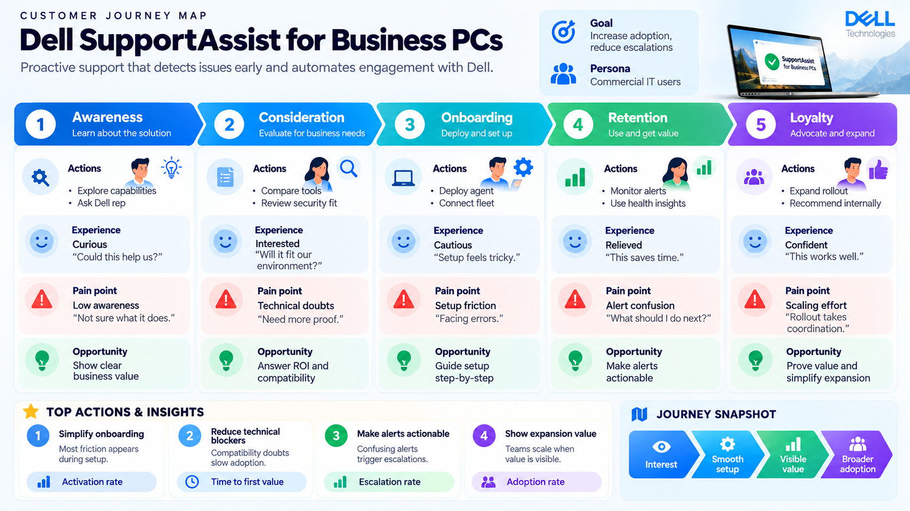
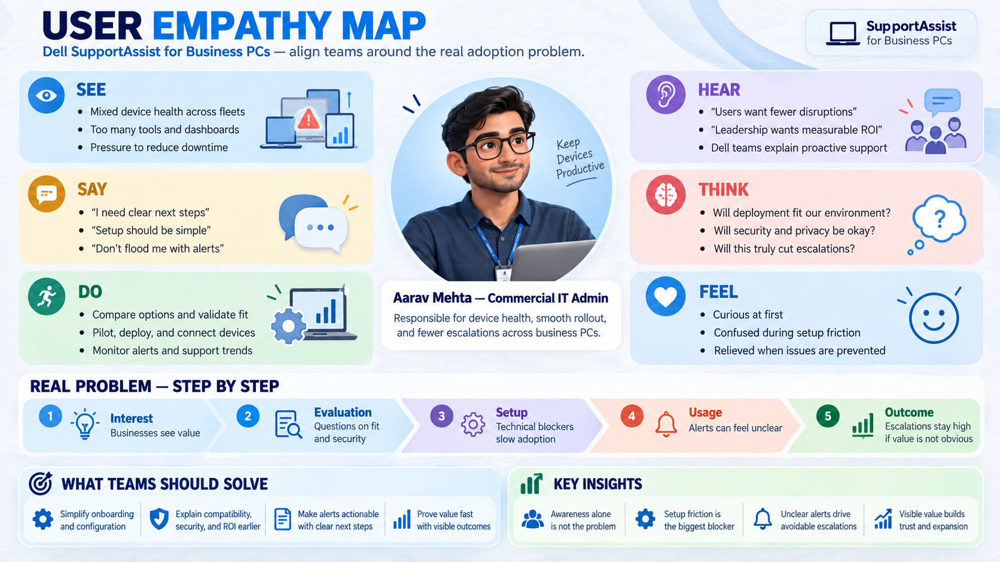

# SupportAssist

<div align="center">
  
  
  
</div>

<p align="center">
  <strong>Customer support operations dashboard</strong>
</p>

SupportAssist is a portfolio-focused support operations platform designed to help teams manage customer issues, monitor SLA compliance, assign work efficiently, and improve service outcomes through a centralized dashboard.

This project demonstrates product thinking, workflow design, and a real-world operations experience that could be used by support teams in SaaS, enterprise service, or customer success organizations.

## Why this project stands out

Support teams usually work across disconnected tools, fragmented ticket tracking, and slow internal coordination. SupportAssist brings the key operational elements together into one system:

- case creation and lifecycle management
- agent and manager workflows
- SLA tracking and escalation visibility
- team workload monitoring
- reporting and operational dashboard insights

It is designed to feel practical, production-oriented, and portfolio-worthy for recruiters and hiring managers.

## Project preview

The current version includes a polished dashboard UI with:

- support overview metrics
- queue distribution visualization
- team health monitoring
- recent ticket table
- priority and SLA states

## Product discovery

These workshop artifacts ground the concept in user needs and adoption challenges. They are product-planning visuals, not screenshots of the current prototype UI.

### Customer journey maps

The journey maps trace the path from initial awareness through onboarding, adoption, and ongoing use, highlighting customer actions, friction points, and opportunities to improve the experience.

<p align="center">
  
</p>

### User empathy map

The empathy map captures what a commercial IT administrator sees, hears, says, thinks, does, and feels while evaluating and adopting SupportAssist.

<p align="center">
  
</p>

## Core features

- Ticket lifecycle management
- Case assignment and routing
- Priority and severity tagging
- SLA tracking with escalation states
- Search and filter workflow
- Support dashboard for operations visibility
- Role-based admin and agent experience
- Audit-friendly activity tracking
- Reporting and performance summaries

## User personas

### Support Agent
Handles customer issues, updates case notes, and resolves tickets within time constraints.

### Team Lead / Manager
Monitors queue pressure, escalations, backlog, and SLA health across teams.

### Administrator
Configures support rules, permissions, teams, and workflow definitions.

## Tech stack

### Frontend
- React
- Vite
- CSS Modules / custom styling

### Planned / recommended backend stack
- Node.js
- Express or NestJS
- PostgreSQL
- JWT-based auth

### Tools
- GitHub
- Docker
- Postman / Swagger
- CI/CD-ready structure

## Architecture overview

The product follows a practical modern architecture:

- frontend dashboard and agent workflows
- backend API layer for tickets, users, teams, and SLA logic
- database for support records, assignments, and activity history
- reporting layer for dashboard metrics and operational insights

For more detail, see [docs/architecture.md](docs/architecture.md).

## Repository structure

```bash
supportassist/
├── src/
│   ├── App.jsx
│   ├── main.jsx
│   └── styles.css
├── assets/
│   ├── supportassist-customer-journey-map.png
│   ├── supportassist-customer-journey-map-summary.png
│   └── supportassist-user-empathy-map.png
├── docs/
│   ├── architecture.md
│   ├── context.md
│   ├── plan.md
│   └── PRD.md
├── .gitignore
├── LICENSE
├── index.html
├── package.json
├── README.md
├── vite.config.js
└── package.json
```

## Getting started

### Prerequisites

- Node.js 18+
- npm
- Git

### Install

```bash
git clone https://github.com/nikhilkiroula-bit/SupportAssist.git
cd SupportAssist
npm install
```

### Run locally

```bash
npm run dev
```

### Build for production

```bash
npm run build
```

## Roadmap

### MVP
- ticket creation and management
- assignment flow
- SLA visibility
- dashboard and metrics panel
- search and filter experience

### Phase 2
- notifications and escalation rules
- richer analytics and reporting
- admin configuration panels
- customer-facing updates

### Phase 3
- automation and AI-assisted triage
- integrations with external systems
- advanced reporting and forecasting

## Portfolio story

This project is valuable as a portfolio piece because it shows a realistic product problem, structured requirements, workflow thinking, and an operational dashboard experience. It reflects how software can solve real business problems rather than just presenting a generic UI.

## License

This project is licensed under the MIT License. See [LICENSE](LICENSE) for details.

## Connect

- GitHub: https://github.com/nikhilkiroula-bit/SupportAssist.git
- Project type: Product / SaaS support operations dashboard
- Goal: portfolio-ready software project

---

Built to be attractive, professional, and easy to understand for recruiters, hiring managers, and technical reviewers.
